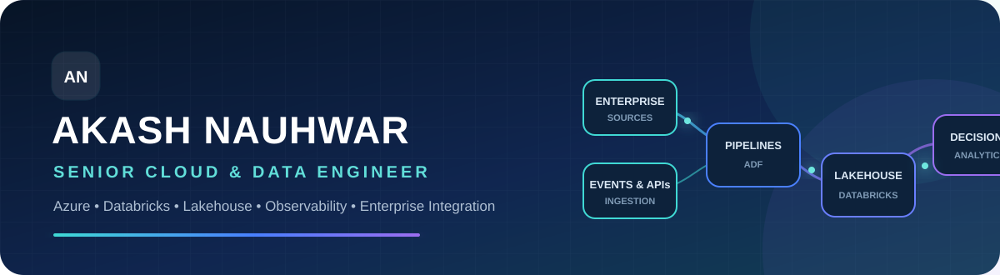

  

  
  
  

  
  
  
  

## 👋 About me

I am a **Senior Cloud & Data Engineer** with **9+ years of enterprise experience**, building data systems from architecture through production. My work connects ingestion, lakehouse transformation, APIs, observability, governance, and FinOps—turning fragmented enterprise data into dependable products and explainable decisions.

> **My engineering lens:** a platform is not finished when the pipeline runs; it is finished when teams can operate it, trust it, explain it, and control its cost.

## 🧭 What I engineer

<table>
  <tr>
    <td width="33%" valign="top">
      <h3>🏗️ Data platforms</h3>
      Azure lakehouses, medallion layers, reusable ingestion contracts, scalable PySpark transformations, and governed analytical products.
    </td>
    <td width="33%" valign="top">
      <h3>📡 Observability</h3>
      Centralized telemetry, KQL analytics, job health, SLA monitoring, lineage, data quality, reprocessing, and cloud FinOps.
    </td>
    <td width="33%" valign="top">
      <h3>🔗 Digital threads</h3>
      Cross-system PLM, ERP, manufacturing, quality, fleet, and regulatory relationships exposed through governed APIs and decision surfaces.
    </td>
  </tr>
</table>

## ⚙️ Core technology

  &nbsp;&nbsp;
  &nbsp;&nbsp;
  &nbsp;&nbsp;
  &nbsp;&nbsp;
  &nbsp;&nbsp;
  &nbsp;&nbsp;
  &nbsp;&nbsp;
  &nbsp;&nbsp;
  

 

| Platform engineering | Architecture & integration | Reliability & governance |
|---|---|---|
| Databricks · ADF · ADLS Gen2 · ADX · Synapse · Snowflake | Lakehouse · Medallion · Event Hub · APIs · SAP HANA | KQL · Azure Monitor · Grafana · RBAC · CI/CD · FinOps |

## 🚀 Featured engineering work

<table>
  <tr>
    <td width="50%" valign="top">
      <h3>✈️ <a href="https://github.com/anauhwar/aerotwin-recovery">AeroTwin Recovery</a></h3>
      Aircraft disruption digital twin spanning PLM, supply, production, delivery, fleet, maintenance, quality, and explainable recovery decisions.  
      <code>Vue</code> <code>FastAPI</code> <code>PostgreSQL</code> <code>Cytoscape</code> <code>Docker</code>
    </td>
    <td width="50%" valign="top">
      <h3>🧬 <a href="https://github.com/anauhwar/medtech-releasegraph">MedTech ReleaseGraph</a></h3>
      Regulated-product digital thread converting requirements, tests, evidence, ERP, manufacturing, and quality records into release readiness.  
      <code>React</code> <code>FastAPI</code> <code>PostgreSQL</code> <code>React Flow</code> <code>Docker</code>
    </td>
  </tr>
  <tr>
    <td width="50%" valign="top">
      <h3>🕸️ <a href="https://github.com/anauhwar/windchill-changegraph-360">Windchill ChangeGraph 360</a></h3>
      Explainable engineering-change impact across parts, BOM paths, ERP alignment, cycle time, and data-quality controls.  
      <code>Python</code> <code>Streamlit</code> <code>Medallion</code> <code>Docker</code>
    </td>
    <td width="50%" valign="top">
      <h3>⚡ <a href="https://github.com/anauhwar/windchill-bomgraph-accelerator">BOMGraph Accelerator</a></h3>
      Configuration-aware BOM reachability and where-used analysis using precomputed graph paths and governed APIs.  
      <code>FastAPI</code> <code>PostgreSQL</code> <code>Python</code> <code>Streamlit</code>
    </td>
  </tr>
</table>

> 🧪 All portfolio datasets are synthetic. Each repository is structured as an enterprise initiative with architecture, data models, implementation plans, quality controls, Docker deployment, and professional documentation.

## 🧠 Engineering principles

- **Design for operations** — monitoring, traceability, reprocessing, ownership, and cost belong in the architecture.
- **Make decisions explainable** — every metric and recommendation should trace to governed records and transformations.
- **Build reusable contracts** — ingestion, medallion layers, APIs, and controls should scale beyond one use case.
- **Measure outcomes** — performance, reliability, adoption, risk, and delivery speed matter more than technology for its own sake.

## 🏅 Credentials

  
<strong>Databricks, Microsoft & delivery excellence</strong>

   

  - 🟥 Databricks Certified Data Engineer Professional
  - 🟥 Databricks Certified Generative AI Engineer Associate
  - 🟦 Microsoft Certified: Azure Data Engineer Associate
  - 🟦 Microsoft Certified: Fabric Analytics Engineer Associate
  - 🟦 Microsoft Certified: Azure Administrator Associate
  - 🟨 Microsoft Certified: Power BI Data Analyst Associate
  - 🟩 Lean Six Sigma Green Belt · Scrum Fundamentals Certified

---

  <strong>📍 Pune, India · Open to senior and lead cloud data engineering opportunities</strong>  
  <a href="https://anauhwar.github.io/Portfolio/">🌐 Explore my portfolio</a>&nbsp;&nbsp;•&nbsp;&nbsp;
  <a href="mailto:akash.nauhwar@outlook.com">✉️ Start a conversation</a>

